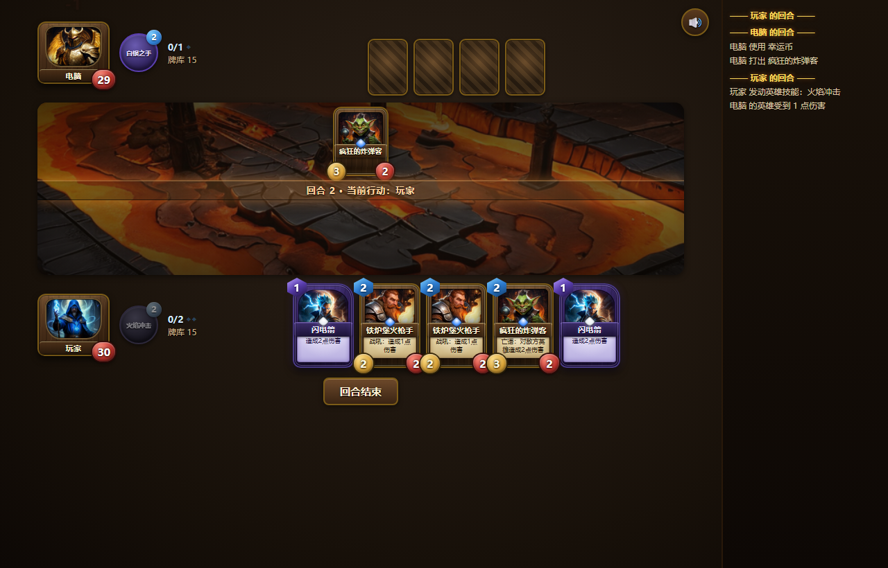
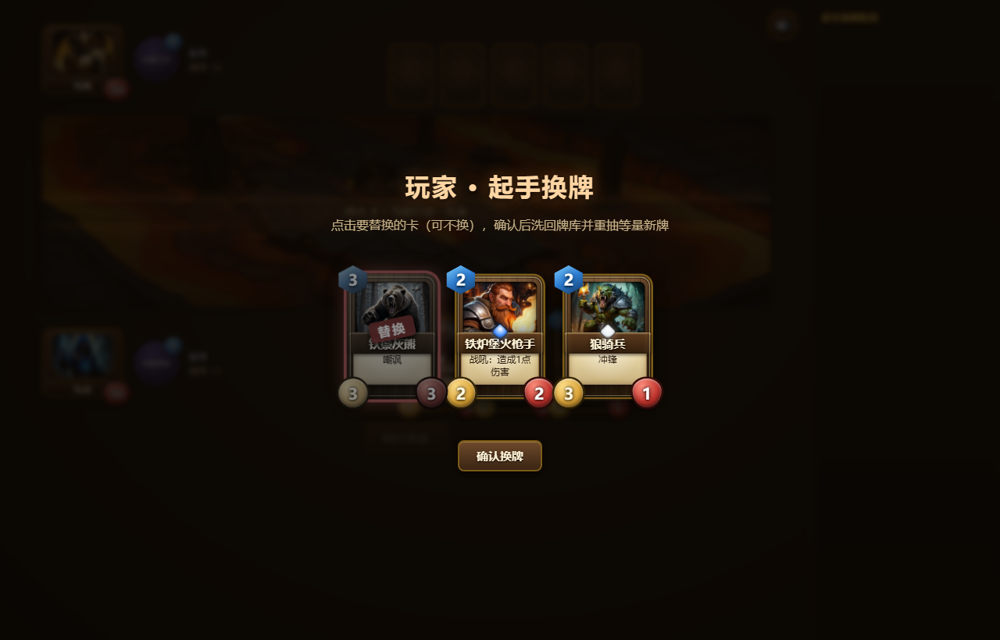

# 炉石简化版 Hearthstone Lite

单个 HTML 文件实现的简化版炉石卡牌对战：人机对战 + 双人同屏，厚涂插画、卡框动效、英雄技能、起手换牌一应俱全。**零依赖、零后端、双击即玩。**

**在线试玩：<https://programmerdream.github.io/hearthstone-lite/>**

| 对局 | 起手换牌 |
|---|---|
|  |  |

## 玩法

- 双方 30 血、20 张固定同卡组、法力水晶每回合 +1（上限 8）、场上随从最多 5 个
- 关键词：**嘲讽 / 冲锋 / 战吼 / 亡语** + 直伤法术，死亡结算支持亡语连锁
- **英雄技能**（每回合一次，2 费）：玩家=法师·火焰冲击（造成 1 点伤害），电脑=圣骑士·白银之手（召唤 1/1 新兵）
- **起手换牌**：先手 3 张 / 后手 4 张 + 幸运币，可任选替换一次
- 后手补偿：多抽 1 张 + 幸运币；牌库抽空进入疲劳
- AI：贪心策略（斩杀检查 → 解场/铺场 → 有利交换否则打脸），与玩家走完全相同的动作入口

## 本地运行

下载 [`index.html`](index.html)（或 `hearthstone-lite.dist.html`，同一文件）双击打开即可，所有插画已内联，无需联网。

开发版为 `hearthstone-lite.html` + `assets/art/`（原始 768² 插画）。

## 技术

- **单文件架构**：卡牌数据 / 纯函数规则引擎 / AI / UI / 动画层 五区分层，引擎不碰 DOM
- **插画**：本地 Stable Diffusion（Forge + DreamShaper XL v2.1 Turbo）批量生成，提示词与种子见 [`assets-gen/card-art.json`](assets-gen/card-art.json)，`gen-art.ps1` 一键重出
- **卡框**：纯 CSS/SVG，`:has(.catk)` 自动区分随从（暖木金框）与法术（尖顶奥术紫框），数值文字全部代码渲染保证清晰
- **动画层**：monkey-patch 引擎动作入口 → 状态快照 diff 派生事件流 → 串行动画队列逐个演出（AoE 逐个碎裂）→ 队列排空后一次全量渲染对齐，引擎零改动
- **音效**：WebAudio 现场合成，无音频文件
- **构建**：`assets-gen/build-inline.ps1` 把插画降采样转 JPEG data URI 内联，产出 1.1MB 自包含单文件

设计文档：[一期（规则与引擎）](炉石简化版设计方案.md) · [二期（美术与动效）](炉石二期实现方案.md) · [三期（玩法深度）](炉石三期实现方案.md)

## 声明

本项目为个人学习作品（AI 辅助编程练习），非商用。卡牌名称借用自《炉石传说》以便理解，插画为本地 AI 生成，与暴雪娱乐无关。
